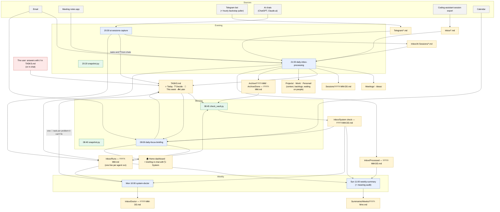

# Architecture — Second Brain agents (current design, v4)

This document describes how the system works today (October 2026, "v4"). It started as a v1 design in August 2026 and has been revised every time something broke in practice; the version registry at the end shows how it got here.

The system is a markdown vault (Obsidian) plus five scheduled AI agents and a few small scripts. The agents read incoming material — email, meeting notes, a Telegram bot, AI chat exports, the calendar — and turn it into one task list, project notes and a short morning briefing. The person using it should only have to do two things: read the briefing and answer questions.

The design rule behind everything below: **every file has one writer, every agent has one output, every error has one place where it shows up.**

## 1. Four principles

1. **One writer per file.** The most common early failure was "a closed task comes back" — and every time, the cause was two agents writing into the same container. The ownership table (section 3) is the rule: an agent that is not listed as a writer of a file does not write to it.
2. **Agents talk through files, not memory.** Scheduled agents have no shared memory between runs. The only channel is the vault. So each agent ends its run by appending one line to the run log (`Inbox/Runs — YYYY-MM.md`): "I ran, here is what I did". The next agent reads that line to know where to start.
3. **Code checks, not the agent.** File exists or not, duplicate or not, section present or not — a plain script (`check_vault.py`) checks this every morning. It does not hallucinate and does not get tired. An agent is used only once a week, to check things that need judgement.
4. **Errors are visible in one place.** The morning briefing has a `🩺 System` block. Not a separate channel, not scattered files — the user already reads the briefing.

## 2. A day in the system



**Schedule**

| Job | Kind | When |
|---|---|---|
| `daily-focus-briefing` | agent | daily 09:00 |
| `ai-sessions-capture` | agent | daily 20:30 |
| `daily-inbox-processing` | agent | daily 21:00 |
| `weekly-summary` | agent | Sunday 11:00 |
| `system-doctor` | agent | Monday 10:00 |
| `check_vault.py` | script (launchd) | 08:45, then every 3 h |
| `snapshot.py` | script (launchd) | 08:40 and 20:20 |
| Telegram backstop puller | script (launchd) | hourly |
| Coding-assistant session export | scheduled routine | 19:00 |

## 3. TASKS.md — one list instead of two

Since v4 (2026-10-19) there are no daily notes. Everything that needs the user's action or answer lives in `TASKS.md`, which has exactly four sections:

1. `## 🔥 Today — <day>` — at most 5. The morning agent fills it; it is empty overnight.
2. `## ❓ Decide` — questions for the user, at most 10. Line: `- ❓ a question answerable with "yes/no" or one word — _day, source_`. No checkbox.
3. `## 📅 This week — until <date>` — what will really get done this week.
4. `## 📥 Later` — everything else in progress, at most 30 lines. Long backlogs, statuses, history and "waiting on people" live in project files.

A task line is deliberately "dumb-simple": one action, imperative verb, about 10 words, a date at the start if there is one, one project emoji at the end.

**The `//` reply convention.** The user answers anything by writing after `//` at the end of a line (or by saying it in chat). The morning and evening agents — whichever runs first — interpret the comment by meaning ("done", "waiting on X", "drop", "move to Friday", "yes, let's do it"…), execute it, archive the line with the outcome, and remove the `//` tail. Agents never write `//` themselves. An unclear comment is not executed; it stays and is listed under "To confirm".

**Closing by evidence.** An open task can be closed without the user only if there is a digital trace: a meeting that took place, a sent email, a "sent / done" note in the project file. Tasks with no digital trace (pay, call, buy) are closed only by the user.

**Dedup against the archive.** Before adding anything, agents check `TASKS.md` and `Archive/Done — YYYY-MM.md` for the last 30 days. Anything already closed (✅ done, ⛔ dropped, ⏳ waiting, 💬 decided) is not added again.

## 4. File ownership

| File / container | Writes | Reads | Rule |
|---|---|---|---|
| `TASKS.md` → 🔥 Today | morning (fills ≤ 5, by moving lines) · evening (empties) | all | nobody adds tasks here directly |
| `TASKS.md` → 📅 / 📥 | evening (new tasks, `//` parsing, hygiene) · capture (tasks from AI chats) · morning (only fresh overnight items) · weekly (promotes / demotes) · doctor (closed list of fixes) | all, check | "verb + gist + emoji"; context goes to the project file |
| `TASKS.md` → ❓ Decide | any agent may add (≤ 3 per run, ≤ 10 total) · morning / evening parse answers | user, all | agents never delete a question without archiving it |
| `Inbox/AI Sessions/` | ai-sessions-capture | evening | evening archives them |
| `Sessions/YYYY-MM-DD.md` | evening | morning, weekly | capture does not write here |
| `Meetings/`, `Ideas/` (from meeting notes) | evening | all | morning only reads recap emails, never creates a note |
| `Projects/`, `Work/`, `Personal/` | evening (updates, backlogs, waiting on people) + manual sessions | all | tasks here are plain text, no checkboxes |
| `Archive/YYYY-MM/`, `Archive/Done — YYYY-MM.md` | evening, morning (`//` outcomes) · doctor (safety net) | all | `Archive/Inbox/` is forbidden |
| `Inbox/Processed — YYYY-MM-DD.md` | morning (`## Morning pass`) + evening (`## Evening pass`) — two sections of one file | weekly audit, doctor | archived after 14 days by the date in its name |
| `Inbox/Runs — YYYY-MM.md` | **every** agent and script — one line per run | everyone | the only contract between runs |
| `Inbox/System check — YYYY-MM-DD.md` | `check_vault.py` only | morning, weekly, doctor | agents never edit it |
| `Inbox/Doctor — YYYY-MM-DD.md` | system-doctor | morning, user | — |
| `🏠 Home` dashboard | morning | user | — |
| `Summaries/Weeks/` | weekly-summary | user, doctor | — |
| `Inbox/`, `Telegram/` (incoming) | bots and routines | evening (processes and archives), morning (reads only fresh items) | morning never moves files |
| `Agent versions.md` | the user, at rollout | check, doctor | change it together with the prompt |

`TASKS.md` is the one deliberate exception to "one writer": several agents write to it, but each owns specific sections and operations, and they run at different times. Because cloud scheduling sometimes starts several runs at once, every agent re-reads `TASKS.md` immediately before writing and applies its edits to the fresh copy.

## 5. The run-log contract

File: `Inbox/Runs — YYYY-MM.md`. Every agent appends one line as its **last** step (the catch-up step comes after it):

```
- 2026-10-20 20:36 | ai-sessions-capture v4.0 | ok | ChatGPT 1, Claude.ai 2, tasks +2, ❓ +1
- 2026-10-20 21:07 | daily-inbox-processing v4.1 | ok | sessions 3, meetings 1, tasks +4, ❓ +1, // parsed 2, [x]→archive 3, by evidence 1, files archived 6
- 2026-10-21 09:04 | daily-focus-briefing v4.1 | ok | 🔥 4, replies executed 1, ❓ open 3, fresh files 0, useful emails 2, by evidence 0, 🩺 ok
- 2026-10-21 09:05 | catch-up | ok | daily-focus-briefing → re-launched: weekly-summary (18.10 11:00)
```

Format: `date time | agent vX.Y | ok/warn/fail | counters`, at most 300 characters.

- **The version stamp is mandatory.** It is the only proof of which prompt text actually ran (see section 8).
- **`warn`** means the agent could not do part of its job (a connector did not answer, a browser session was logged out, all sources returned zero). The reason goes in one sentence. An extended window is *not* a `warn`.
- **The window rule.** An evening agent starts collecting from the time of its own last `ok`/`warn` line (never earlier than 4 days back). If the computer slept for two days, the window widens by itself and nothing is lost. `fail` and `(addendum)` lines do not count.
- **Late runs.** A run between midnight and noon is treated as last night's run: files are named with yesterday's date and the report starts with a late-run warning.
- **The morning agent** checks whether the evening agents ran; if not, it says so in 🩺 and never pretends "nothing happened yesterday".

## 6. Error matrix

| Symptom | Who catches it | What it does by itself | What the user sees |
|---|---|---|---|
| Computer asleep, evening runs did not start | `check_vault.py` (no run-log lines, no file traces) | nothing — not a failure | 🩺: "no runs yesterday — computer was asleep; next run will collect from <date>" |
| Evening runs slipped past midnight | the agent itself (window rule) | names files with yesterday's date | ⚠️ note in `Processed` |
| A colleague missed its slot (cloud scheduler did not re-run it) | the next agent that runs (catch-up step) | re-launches it with `fire_trigger`, writes a `catch-up` line | "re-launched: …" in the summary |
| Platform disabled a scheduled task | system-doctor (`list_triggers` → `enabled`) | — | a 🧠 task: "enable it in Scheduled" |
| Agent's run-log version ≠ registry | `check_vault.py` daily, doctor weekly | — | ⚠️ + a 🧠 task: "paste the current prompt into the task" |
| `Archive/Inbox/` reappeared | `check_vault.py`, doctor | moves contents to `Archive/YYYY-MM/` | 🩺 🔧 |
| Exact duplicate files (e.g. an exporter re-uploading old logs) | `check_vault.py` | moves the copy to `_to_delete/duplicates/` | 🩺 🔧 |
| `[x]` left in TASKS.md in the morning | `check_vault.py` | — | ⚠️ "evening agent skipped its step"; doctor archives if still there |
| Old-format lines or extra sections in TASKS.md | `check_vault.py` | — | ⚠️ "some agent runs on old rules" |
| `📥 Later` > 30 lines, `❓ Decide` > 10 | `check_vault.py` | — | ⚠️; evening agent / doctor move the excess to project backlogs |
| `Daily/` notes created again after v4 | `check_vault.py`, doctor | — | ⚠️ "a task runs an old instruction" — doctor names which |
| Work files changed but `Sessions/` says "No sessions" | `check_vault.py` | — | ⚠️ → weekly audit |
| Files sit in `Inbox/AI Sessions/` > 2 days | `check_vault.py` | — | ⚠️ "capture works, the evening agent does not pick them up" |
| Telegram puller has not completed a run in > 6 h | `check_vault.py` (success marker file) | — | ⚠️ → doctor turns it into a task with a command |
| No fresh snapshot for > 26 h, or TASKS.md shrank by half in 3 days | `check_vault.py` | — | ⚠️ with the path to the intact copy |
| Session export lagging | `check_vault.py` (marker + dedup log) | — | ⚠️ → doctor task |
| Connector (email, meeting notes) did not respond | the agent itself | `warn` in the run log, skips the source, does **not** report an empty day | 🩺 via the run log + `Processed` |
| All sources returned zero | evening agent (plausibility step) | widens the window to 4 days, re-checks the time | "⚠️ may be a failure, not an empty day" |
| A closed task came back | doctor (compares TASKS with `Done`) | re-archives it | listed under "Fixed" |
| An agent rewrote the user's line / wrote `//` itself | weekly audit | — | "System this week" section in the weekly summary |

**Rule for every agent:** a connector error is not "nothing happened". Always write `warn`, say which source was skipped, and carry on with the remaining steps.

**New vs known warnings.** Each warning has a stable key (text without numbers and dates). A warning not seen in the last 48 hours is "new": it goes to the top of the report and triggers a desktop notification. Known warnings are listed below with "open since dd.mm". Without this, a checker that always says `warn` trains everyone to ignore it.

## 7. The two-level checker

### 7a. Daily, code: `check_vault.py`

Runs from launchd at 08:45 and every 3 hours. It looks back over the last 3 days (so it catches up on gaps), is **idempotent** (can run any number of times) and deletes nothing. It writes `Inbox/System check — YYYY-MM-DD.md` (overwritten on each run) and a line in the run log.

It checks: run-log lines against the expected schedule and against traces in files; versions against the registry (including whether a missed slot was caught up); the four TASKS.md sections and their limits; checkboxes outside TASKS.md; stale Inbox files; exact duplicates; `Archive/Inbox/`; the sessions file against changed work files; the Telegram puller's success marker; the session export; snapshots; notes that vanished or shrank sharply.

It fixes only safe, mechanical things: moving `Archive/Inbox/*` and moving exact duplicates to `_to_delete/duplicates/`.

### 7b. Weekly, agents: meaning audit + doctor

- **`weekly-summary` (Sunday)** reads the week's checks, `Processed` reports, run log, `Done` archive and TASKS.md, and looks for what code cannot see: a task that came back after `[x]`, an agent rewording the user's line, context leaking into TASKS, duplicate meeting notes, missed slots that were never caught up. It writes a "🩺 System this week" section and suggests 1–3 instruction fixes. It does not edit instructions.
- **`system-doctor` (Monday)** looks at the whole system: are the agents alive and on the right version, did runs happen, are the inputs alive. It fixes a closed list of problems inside the vault itself. For everything outside its sandbox (scripts, launchd, the scheduler, the phone) it creates exactly one task for the user with a ready-made command, and checks next week whether the command helped.

## 8. Version registry and the deploy rule

`Projects/Second Brain/Agent versions.md` lists the version each agent is expected to run:

| Agent | Expected version | Status | Schedule |
|---|---|---|---|
| daily-focus-briefing | 4.1 | active | daily 09:00 |
| ai-sessions-capture | 4.0 | active | daily 20:30 |
| daily-inbox-processing | 4.1 | active | daily 21:00 |
| weekly-summary | 3.0 | active | Sunday 11:00 |
| system-doctor | 2.1 | active | Monday 10:00 |
| check-vault (script) | 2.7 | active | launchd 08:45 + every 3 h |
| snapshot (script) | — | active | launchd 08:40 and 20:20 |
| Telegram puller (script) | — | active | launchd hourly; liveness = success marker |
| session export (routine) | — | active | 19:00; liveness = marker + run-log line |

Every prompt has a `version:` in its frontmatter and writes that version into its run-log line. The checker compares the stamp with the registry. A mismatch means "the new text did not land".

**Deploy rule: a file on disk is not proof the agent runs it.** The scheduler may execute its own stored copy of the prompt rather than the file in `<scheduled-tasks-dir>`. So a rollout is:

1. bump `version:` in the prompt;
2. update the registry;
3. put the file in `<scheduled-tasks-dir>/<agent>/SKILL.md` **and** paste the same text into the scheduled task's own prompt;
4. press "Run now" once.

The status becomes "active" only after a run-log line with the new version appears.

**Blind spot for weekly agents.** For a weekly agent, "no line with the new version yet" may simply mean it has not had a slot since the rollout. Before reading a mismatch as a failed rollout, compare the rollout date with the agent's schedule.

**Snapshots.** Twice a day `snapshot.py` copies the files agents rewrite daily (TASKS.md, CLAUDE.md, the dashboard, the registry, the `Done` archive, all scheduled prompts) to a folder **outside** the vault, and keeps them for 30 days. Rolling back means opening the snapshot from before the damage, moving the broken file to `_to_delete/`, copying the good version back, and logging what was rolled back and why.

## 9. Catch-up between agents

The cloud scheduler runs each slot at most once. If the computer is asleep at the scheduled time, the slot is either skipped or delivered hours later, and it is marked "succeeded" even if the session could not reach the vault. Nothing re-runs a missed slot when the computer wakes up.

So the agents catch up for each other. At the end of each run (after its own run-log line), each of the four daily/weekly agents:

1. skips the step if it was itself launched as a catch-up, or if there is a `| catch-up |` line younger than 60 minutes (the run log acts as a lock);
2. calls `list_triggers` and, for each enabled colleague, works out the last slot that has passed;
3. treats a slot as missed if **all three** hold: it passed more than 60 minutes ago; the run log has no `ok`/`warn` line from that agent at or after slot − 2 h (some lines are in UTC); and `last_fired_at` is older than 45 minutes;
4. ignores slots older than 48 hours (those belong to the doctor), re-launches the briefing only before 14:00 and the weekly summary only on Monday–Tuesday;
5. re-launches each missed colleague with `fire_trigger` ("catch-up for <slot>, launched by <agent>"), in order capture → inbox → briefing → weekly → doctor, and writes one `catch-up` line.

The re-launched agent sees the word "catch-up", uses the widened window from the run log, adds `catch-up for dd.mm` to its own run-log line (the marker `check_vault.py` uses to count the missed evening as covered), and does not trigger anyone else.

**Known limitation (found 2026-10-14).** A task re-launched through `fire_trigger` may run in the cloud only, without access to the local computer — no vault and no local browser. So the success signal is never "fire_trigger was called"; it is "the agent's own line appeared in the run log afterwards". For agents that need the local machine, the next regular run with its widened window remains the real safety net.

## 10. Version history (short)

| Date | Change |
|---|---|
| 2026-08-18 | v1 architecture: four principles, ownership table, run log, error matrix, daily code check + weekly audit. |
| 2026-10-02 | Version stamps in the run log + the registry, after two of four updated prompts silently failed to land. |
| 2026-10-06 | Scripts, virtualenvs and logs moved out of the synced Documents folder; success-marker liveness; snapshots; new-vs-known warnings. |
| 2026-10-12 | Catch-up between agents; re-read TASKS.md before every write; weekly summary moved from Sunday evening to Sunday 11:00 after two missed Sundays. |
| 2026-10-13 | Catch-up tuned: slot − 2 h tolerance for UTC lines, briefing only before 14:00, weekly only Mon–Tue; capture retries a logged-out browser before giving up. |
| 2026-10-19 | **v4 — one list instead of two.** Daily notes retired; all actions and questions in TASKS.md with a new `❓ Decide` section; `//` is the only reply mechanism. |
| 2026-10-20 | Briefing 4.1: full text goes to chat, not only a push notification. |
| 2026-10-21 | Inbox 4.1 / doctor 2.1: service reports archived after 14 days by the date in the file name, with link fixing. |
